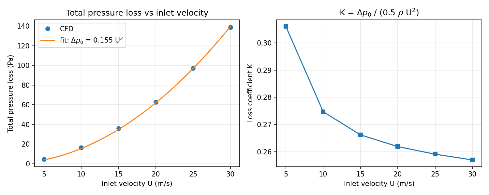

# OpenFOAM velocity sweep: pressure loss over a backward-facing step

A Python workflow that automates a parametric CFD study in OpenFOAM and analyses the results. It runs the classic **pitzDaily** backward-facing step (steady RANS, k-epsilon) at a range of inlet velocities, then works out how pressure loss and pumping power scale with flow speed.



## What the script does

For each inlet velocity, `pitzdaily_sweep.py`:

1. Copies the pitzDaily case into its own folder.
2. Sets the inlet boundary conditions:
   - velocity `U` to the new value
   - turbulent kinetic energy `k` scaled with U² (same turbulence intensity)
   - dissipation rate `epsilon` scaled with U³ (same turbulence length scale)
3. Runs `blockMesh` and the steady solver (`simpleFoam`, or `foamRun` on newer openfoam.org versions).
4. Reads the mesh and result files directly in Python and calculates, at the inlet and outlet:
   - area-averaged static pressure
   - mass-flow-weighted total pressure (p + ½|U|²)
5. Reports:
   - total pressure loss Δp₀ (Pa)
   - loss coefficient K = Δp₀ / (½ρU²)
   - pumping power Δp₀ × Q (W per metre of width)
   - a mass-balance check between inlet and outlet
6. Saves `results.csv` and a plot.

## How to run

Load your OpenFOAM environment, then:

```bash
python3 pitzdaily_sweep.py                                 # default: 5, 10, 15, 20 m/s
python3 pitzdaily_sweep.py --velocities 5 10 15 20 25 30   # custom range
python3 pitzdaily_sweep.py --out runs_tight                # separate output folder
python3 pitzdaily_sweep.py --case /path/to/pitzDaily       # use a specific case
```

The script finds the pitzDaily tutorial automatically. If your OpenFOAM install has no tutorials (some Docker images), copy the `pitzDaily` case into a folder named `pitzDaily` next to the script.

Requirements: OpenFOAM (tested with the openfoam.com Docker image on Windows), Python 3, and `matplotlib` for the plot.

## Results

Mesh: 12,225 cells (2D). Fluid: air, ρ = 1.2 kg/m³, ν = 1×10⁻⁵ m²/s.

| Inlet velocity (m/s) | Iterations | Total pressure loss (Pa) | Loss coefficient K | Pumping power (W/m) |
|---:|---:|---:|---:|---:|
| 5  | 348 | 4.59   | 0.306 | 0.58  |
| 10 | 281 | 16.48  | 0.275 | 4.19  |
| 15 | 289 | 35.94  | 0.266 | 13.69 |
| 20 | 292 | 62.85  | 0.262 | 31.93 |
| 25 | 295 | 97.15  | 0.259 | 61.69 |
| 30 | 297 | 138.76 | 0.257 | 105.73 |

Full data: [`results_baseline.csv`](results_baseline.csv)

**Findings**

- Total pressure loss scales as roughly **U^1.9**. The loss coefficient falls from 0.31 to 0.26 and levels off as the flow becomes fully turbulent and the loss stops depending on Reynolds number. This is close to the textbook sudden-expansion loss of about 0.25 for this step.
- Static pressure **rises** across the step, because the flow slows as it expands. The real energy loss is the drop in total pressure.
- Pumping power scales as roughly **U^2.9**. Doubling the speed from 15 to 30 m/s increases the power needed by 7.7 times. This is why reducing pressure losses matters so much for fuel and energy use in fluid machinery and vehicles.

## Convergence check

To check that the results do not depend on the solver's stopping criteria, I tightened the residual targets tenfold (p: 1e-2 → 1e-3; U, k, epsilon: 1e-3 → 1e-4) and raised the iteration limit from 2,000 to 5,000.

| Inlet velocity (m/s) | Total pressure loss, baseline (Pa) | Tight convergence (Pa) | Change |
|---:|---:|---:|---:|
| 5  | 4.591  | 4.582  | -0.2% |
| 10 | 16.482 | 16.480 | 0.0%  |
| 15 | 35.942 | 35.720 | -0.6% |
| 20 | 62.851 | 62.389 | -0.7% |

All results changed by **less than 1%**, so the original settings were adequate. At 5 m/s the stricter run reached the 5,000-iteration limit without meeting the tighter targets, but its result had stopped changing.

Full data: [`results_tight_convergence.csv`](results_tight_convergence.csv) | Plot: [`loss_vs_velocity_tight_convergence.png`](loss_vs_velocity_tight_convergence.png)

## Limitations

- 2D case with a single turbulence model (k-epsilon).
- The outlet flow rate is estimated from cell-centre velocities rather than OpenFOAM's exact face fluxes. This explains the constant 0.4% mass imbalance, which did not change with tighter convergence.
- No mesh independence study yet.

## Next steps

- Mesh independence check: refine the mesh and confirm the loss coefficient does not change.
- Compare k-epsilon with k-omega SST.
- Use OpenFOAM's face flux field (`phi`) for an exact mass balance.

## Author

Muhammad Taimoor Aslam Sial, MSc Engineering Management (Distinction), BSc Mechanical Engineering. October 2026.
